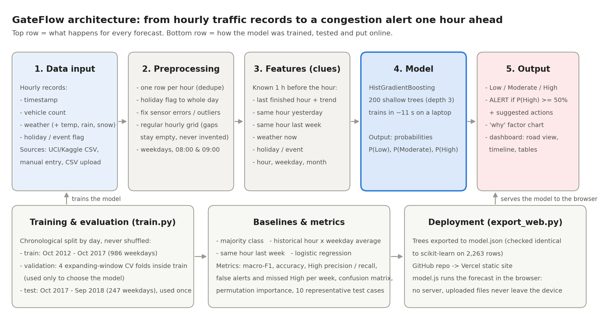

# 🚦 Smart Traffic Congestion Alert: Campus Gate (8–10 AM)

An AI prototype that forecasts congestion (**Low / Moderate / High**) on the approach road to the campus
gate, **1 hour ahead**, for weekday arrivals between 08:00 and 10:00. It shows the factors behind each
prediction and raises an alert when High congestion is expected.

**Web dashboard (`public/`):** a static site, so it deploys straight to Vercel. The trained model is exported to JSON and
runs **in the browser** (`public/model.js`), giving the same output as scikit-learn (checked by `tests/parity.test.mjs`).
A Streamlit version (`app.py`) is kept for local use.

> **Honesty note:** the model is trained on a **real public dataset** (hourly I-94 traffic counts) used as a
> stand-in for the campus road. **No live traffic feed is integrated.** The dashboard replays held-out
> historical days or runs what-if scenarios.

## Submission package (hackathon checklist)

| Checklist item | Where to find it |
|---|---|
| Report file | [`docs/GateFlow_Report.pdf`](docs/GateFlow_Report.pdf) · [`.docx`](docs/GateFlow_Report.docx) · [`REPORT.md`](docs/REPORT.md) |
| PPT | [`docs/GateFlow_Presentation.pptx`](docs/GateFlow_Presentation.pptx) (15 slides with speaker notes, following the suggested flow) · [`PDF`](docs/GateFlow_Presentation.pdf) |
| Demo | The web dashboard in `public/` (deployed on Vercel) · 2-minute demo script in [`docs/EXPLAINER.md`](docs/EXPLAINER.md#13-two-minute-demo-script) |
| Problem definition and intended users | Report §2 · website tab *About & Responsible AI* |
| Architecture / workflow diagram | [`docs/architecture.png`](docs/architecture.png) (data input → processing/model → output) |
| Dataset source, labels, preprocessing, train/validation/test split | Report §4 · [Dataset](#dataset) and [Approach](#approach) below |
| Working prototype, clearly labelled proof of concept | `public/` web app (6 tabs) · "no live feed" banner on every page |
| Evaluation with metrics and test cases, failures included | Report §6 · [`reports/test_cases.md`](reports/test_cases.md) · [`reports/evaluation.md`](reports/evaluation.md) · website *Model performance* tab |
| Responsible AI: privacy, bias, security, accessibility, limitations, human oversight | Report §8 · website *About & Responsible AI* tab |
| SDG alignment | Report §9 (SDG 11.2, 3.6/3.9, 13, 9.1, 4) · website and slide 13 |
| Implemented vs planned | Report §11 · slide 14 · website *About* tab |
| Plain-language explainer for presenting | [`docs/EXPLAINER.md`](docs/EXPLAINER.md) |



## Demo CSV files (for the Upload CSV tab)

Three ready-made files in [`public/demo/`](public/demo/). They are cut from the **held-out test year**, so the model never saw them. On the website they load with one click under *Upload CSV → Demo files*. Regenerate them with `python make_demo_csvs.py`.

| File | Period | What it shows | Result |
|---|---|---|---|
| [`1_busy_week_alerts.csv`](public/demo/1_busy_week_alerts.csv) | 13–24 Aug 2018 | Busy late-summer weeks; State Fair day (23 Aug) | 20 forecasts, 7 High alerts, all 6 real High hours caught, 1 false alarm |
| [`2_holiday_weeks.csv`](public/demo/2_holiday_weeks.csv) | 18 Dec 2017 – 5 Jan 2018 | Christmas and New Year: quiet mornings | 30 forecasts, 0 alerts, 27/30 correct, every holiday correctly Low |
| [`3_winter_live_forecast.csv`](public/demo/3_winter_live_forecast.csv) | 29 Jan – 9 Feb 2018 (ends Fri 07:00) | Snow, a missed sudden surge (5 Feb), and live-style use | 20 forecasts, 14/18 correct, 1 miss, 1 false alarm; the last 2 forecasts show "not known yet", as they would in real use |

## Agentic AI layer (new tab)

The ML model learns patterns from history, so it **can't react to one-off events** such as a crash, a closed road or roadworks. The *Agentic AI* tab adds an agent **on top of** the model. The model itself is not changed.

**Loop:** observe (read the ML forecast) → plan → act (call tools) → reason → reflect (cross-check sources) → decide, repeated until it can decide.

| Tool | What it returns |
|---|---|
| `get_traffic_incidents` | Government traffic incident feed (crashes, breakdowns, closures) |
| `get_roadworks` | Government roadworks / construction permits |
| `get_news_reports` | News stations and public reports |
| `web_search` (Claude engine, live mode) | Real, current news and government pages for the location you type |

**Rules the agent follows:**
- A confirmed full closure on the route during the arrival window means **High** (about 97%).
- A lane closure raises P(High) in proportion to the capacity lost.
- An unverified rumour never triggers an alert on its own: the forecast is kept and a human check is requested.
- Events that are off the route, or outside the arrival window, are ignored.

**Two engines:**
- **Built-in (offline):** a deterministic planner that runs in the browser with no key.
- **Claude agent:** `claude-opus-5-5` drives the same tools through a tool-use loop.
    - It runs with summarized thinking, and server-side refusal fallback is enabled (`fallbacks: "default"`).
    - With **Live mode** it uses Claude's web search to look for real reports near the campus. The default location is VIT Vellore.
    - The API key is typed into the page, kept in memory only, and sent only to `api.anthropic.com`.

**The 5 demo scenarios** in `public/agent/scenarios.json`:
- Calm morning
- Accident blocks the road
- Roadworks close one lane
- Unverified rumour
- Crash already cleared

The base forecasts are real ML forecasts on held-out days. The incident and news items are **simulated examples**, in the format a government or news feed returns.

## Dataset

**Metro Interstate Traffic Volume**: UCI Machine Learning Repository, id 492 (the same file is mirrored on Kaggle). License: CC BY 4.0.
48,204 hourly rows, Oct 2012 to Sep 2018, westbound I-94 (Minneapolis–St Paul, MN DoT ATR station 301).

| Required field | Column used |
|---|---|
| timestamp | `date_time` |
| vehicle count | `traffic_volume` (vehicles/hour) |
| weather condition | `weather_main` (grouped: Clear, Clouds, Rain, Snow, Fog/Mist), plus `temp`, `rain_1h`, `snow_1h`, `clouds_all` |
| event indicator | `holiday` (US holidays and the State Fair), spread from the midnight row to the whole day |

Cleaning (`features.load`):
- Removed 7,629 duplicate hours (one row per weather condition), keeping the worst weather for each hour.
- Reindexed to a regular hourly grid, which exposes the Aug 2014 – Jun 2015 sensor gap as NaN.
- Removed 0 K temperature errors and clipped a 9,831 mm rain outlier.

## Approach

**Congestion classes:** the dataset has no speed data, so the label is a volume-to-capacity proxy:

| Class | Hourly volume | Meaning |
|---|---|---|
| Low | < 5,000 veh/h | free flow |
| Moderate | 5,000 – 5,800 | dense, still moving |
| High | ≥ 5,800 | ≥ ~85% of max observed throughput (~6,900 veh/h), near saturation |

**Prediction setup (no leakage):** at 07:00 the model predicts the 08:00–09:00 hour, and at 08:00 it predicts 09:00–10:00.
It uses only information available at prediction time:

| Factor group | Features |
|---|---|
| Recent volume & trend | last completed hour, the hour before, and the change between them |
| Usual volume | same hour yesterday, same hour last week |
| Weather | current condition, temperature, rain, snow, cloud cover |
| Holiday / event | holiday or event day flag (known in advance) |
| Calendar | target hour, day of week, month |

**Models (lightweight; the full pipeline trains in about 10 s on a laptop CPU):**
- Logistic regression (median imputation + scaling)
- **HistGradientBoosting** (shallow trees, depth 3, handles missing lags natively) ← selected

**Baselines:** majority class, historical average for the same hour and weekday, and same hour last week (persistence).

**Evaluation protocol:**
- Chronological split by day: train on Oct 2012 – Oct 2017 (986 weekdays), test on the **held-out last 20%** (247 weekdays, 18 Oct 2017 – 28 Sep 2018).
- The model is chosen by 4-fold expanding-window CV on **training days only**, so the test set is used once.

**Explainability:**
- Global: group permutation importance (shuffle one factor group, measure the macro-F1 drop).
- Per prediction: the change in P(High) when one factor is reset to a "calm" reference (median volumes, Clear weather, no holiday).

## Results (held-out test set, 494 forecasts)

| Model | Accuracy | Macro-F1 | High precision | High recall | False alerts / week | Missed High / week |
|---|---|---|---|---|---|---|
| Majority class | 0.512 | 0.226 | 0.000 | 0.000 | 0.00 | 1.98 |
| Historical average (hour × weekday) | 0.547 | 0.397 | 0.000 | 0.000 | 0.00 | 1.98 |
| Same hour last week | 0.619 | 0.607 | 0.612 | 0.612 | 0.77 | 0.77 |
| Logistic regression | 0.654 | 0.660 | 0.515 | 0.898 | 1.42 | 0.28 |
| **HistGradientBoosting** | **0.735** | **0.733** | 0.609 | 0.796 | 0.95 | 0.40 |

- The model raises macro-F1 from 0.607 (best baseline) to **0.733** and catches **80% of High-congestion hours**. That works out to about 0.4 missed High hours and 1 false alert per week (10 forecasts a week).
- Predicting **2 hours ahead** still reaches macro-F1 0.688 (High recall 0.92).
- Top factors: recent volume & trend (0.19 drop in macro-F1), then usual volume yesterday / last week (0.14). Weather and holiday add little *on average*, because snow days and holidays are rare in the test year. Their effect shows up per prediction in the dashboard.

Full write-up with charts: [`reports/evaluation.md`](reports/evaluation.md).

## Run it

```bash
pip install -r requirements.txt
python train.py              # cleans data, trains, evaluates, writes models/ and reports/
python make_test_cases.py     # representative test cases + error analysis (reports/, public/)
python make_demo_csvs.py      # three demo CSVs for the Upload tab (public/demo/)
python export_web.py         # exports model + held-out days to public/ (checks parity with sklearn)
node tests/parity.test.mjs   # browser model == sklearn, browser features == Python features
python -m http.server 8600 -d public   # web dashboard at http://localhost:8600
streamlit run app.py         # optional: Streamlit version at http://localhost:8501
```

## Deploy to Vercel

The web dashboard is plain static files in `public/`, with no build step and no server. `vercel.json` tells Vercel to serve
that folder as-is, and `.vercelignore` keeps the Python pipeline out of the deployment.

1. Go to vercel.com → **Add New… → Project** and import this GitHub repo.
2. Leave the defaults. The framework preset is "Other", and `vercel.json` already sets the output directory to `public`.
3. Click **Deploy**. Every later push to `main` redeploys automatically.

If you retrain, run `python export_web.py` again and commit the updated `public/model.json` and `public/test_days.json`.

`python train.py --lead 2` retrains for 2-hour-ahead alerts.
The raw data is included in `data/raw/`. To re-download it: https://archive.ics.uci.edu/static/public/492/metro+interstate+traffic+volume.zip

## Dashboard

The web dashboard (`public/`) has six tabs. Replay, What-if, Manual entry and Upload CSV are also in the Streamlit app (`app.py`). The web version adds *Model performance* (metrics, confusion matrix and clickable test cases) and *About & Responsible AI*. Each tab has a deep link, for example `/#about`.

- **Replay a held-out test day:** pick any test weekday and arrival hour. You see the forecast, the alert, and what actually happened.
  Try **Wed 12 Sep 2018, 08:00**: it is rainy, the model gives P(High) = 99%, and the actual volume was 6,297 veh/h (High).
- **What-if scenario:** set recent counts, weather, month and holiday flag with sliders to see how the forecast reacts.
- **Manual data entry:** feed in your own readings. They go through the same cleaning and feature code as the training data:
  - **Type readings:** pick a date and arrival hour, then type the hourly vehicle counts and weather into an editable table.
    Same-hour-yesterday and last-week counts are optional. The forecast updates as you edit.
  - **Upload CSV:** a file in the dataset's format. `date_time` and `traffic_volume` are required. `weather_main`, `temp` (Kelvin),
    `rain_1h`, `snow_1h`, `clouds_all` and `holiday` are optional and get defaults if missing.
    Every weekday 08:00 / 09:00 hour gets a forecast, including the next one after your last reading.
    The forecast table can be downloaded, and a **template CSV** with real readings is provided.
- **Alert banner:** when P(High) ≥ 50% it suggests actions (leave earlier, open Gate 3, marshal, extra shuttle).
- **Road view:** a schematic map mock-up, coloured by the latest volume and the forecast level.
- **Factor chart:** what pushed this particular prediction up or down.
- **Model evaluation tab:** the metrics, confusion matrices, factor importance and lead-time table.

## Project structure

```
features.py       data cleaning, feature engineering, factor attribution (shared)
train.py          baselines + models, time-series CV selection, held-out evaluation, report
export_web.py     exports the trained trees + held-out days to JSON for the browser
public/           static web dashboard (index.html, app.js, model.js, styles.css, model.json, ...)
tests/            parity test: browser model and features vs scikit-learn / Python
app.py            Streamlit dashboard (local alternative)
data/raw/         Metro_Interstate_Traffic_Volume.csv.gz (UCI / Kaggle)
models/           congestion_model.joblib
reports/          evaluation.md, test_cases.md, metrics.json, test_predictions.csv, *.png
docs/             report (md/docx/pdf), presentation (pptx/pdf), explainer, architecture diagram, screenshots
make_test_cases.py  picks representative successes and failures, writes the error analysis
vercel.json       static deployment config (serves public/)
```

## Limitations and next steps

- **Proxy labels:** congestion is inferred from volume. On the real campus road, label with speed or queue length (camera, GPS probes, Google/HERE traffic) and retrain.
- **Stand-in road:** the pipeline is road-agnostic. Swap in campus counts with the same four fields and rerun `train.py`.
- **Hourly data:** the 5- or 15-minute resolution of a campus counter would allow finer, earlier alerts.
- **Weather and events:** add a weather-forecast API and the college calendar (exams, fests) as event inputs.
- **Congestion propagation:** following Nagy & Simon (2021), *Improving traffic prediction using congestion
  propagation patterns in smart cities*, Advanced Engineering Informatics 50, 101343, adding upstream or neighbouring segment
  counts is the most promising extra feature once multiple sensors exist.

## Citation

Hogue, J. (2019). Metro Interstate Traffic Volume [Dataset]. UCI Machine Learning Repository. https://doi.org/10.24432/C5X60B
