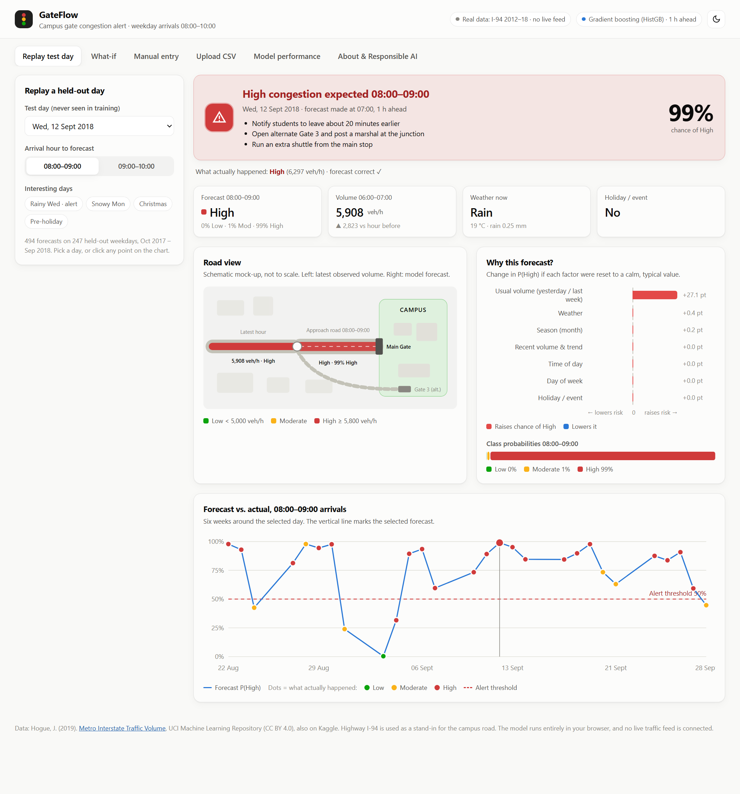

# GateFlow: Smart Traffic Congestion Alert for Campus Arrivals

**VIT AI Innovate-A-Thon, October 2026 · Question 2: Smart Traffic Congestion Alert**
Repository: https://github.com/AnmolDiwan/gateflow-congestion-alert

> **Proof of concept.** GateFlow is trained and tested on a real public traffic dataset (hourly counts on highway I-94, 2012–2018). That road stands in for the campus approach road. **No live traffic feed is connected.** The dashboard replays held-out days and accepts manual or CSV input.

---

## 1. Summary

GateFlow forecasts the congestion level (**Low / Moderate / High**) on the road to the campus gate **one hour ahead**, for weekday arrivals between 08:00 and 10:00. When High is likely (P(High) ≥ 50%), it raises an alert with suggested actions and shows which factors drove the forecast.

On a full year the model never saw (Oct 2017 – Sep 2018, 494 forecasts), the model:
- scores **macro-F1 0.733**, against **0.607** for the best simple baseline and 0.660 for logistic regression;
- catches **80% of High-congestion hours**, with about **one false alert per week** (out of 10 forecasts a week).

The model is a lightweight gradient-boosted tree model that trains in about 11 seconds on a laptop. It is exported to JSON and runs inside the browser on a static website deployed from GitHub to Vercel.

## 2. Problem definition and intended users

Most students reach campus between 08:00 and 10:00. Congestion on the approach road depends on vehicle volume, weather and events. On bad mornings students are late, and crowded gates are unsafe. A warning is only useful if it comes **before** the jam, so we forecast one hour ahead.

| Intended user | Need | What GateFlow gives them |
|---|---|---|
| Transport / admin office | Decide on extra shuttles, open a second gate, post marshals | At 07:00, an alert for 08:00–09:00 with suggested actions |
| Gate security staff | Know when crowds will peak | A simple level (Low / Moderate / High) plus the reason |
| Students and staff | Leave on time | A "leave about 20 minutes earlier" message, shared by the office |
| Shuttle operators | Plan trips around peaks | Forecasts for every weekday peak, downloadable as CSV |

**Task requirements and where they are met:**

| Requirement | Where |
|---|---|
| Congestion classes Low / Moderate / High | Section 4.2 |
| Show influencing factors | Section 6.4 and the dashboard's "Why this forecast?" chart |
| Alert when High is expected | Section 7 and the dashboard alert card |
| Compare with a simple baseline, report metrics | Sections 6.1–6.3 |
| Dashboard or map-style mock-up | Section 7 (road-view mock-up) and the live site |
| Reproducible model | Section 9 (`python train.py`) |
| Evaluation on a held-out test set | Section 5.3 and Section 6 |
| No false claim of live integration | The banner on every page, plus this report |

## 3. Proposed idea and innovation

- **A forecast, not just a classifier:** the model predicts the *next* hour using only information available at forecast time. It never uses the count it is trying to predict.
- **Explainable on every forecast:** each prediction shows how much each factor (recent traffic, usual traffic, weather, holiday, calendar) pushes the chance of High up or down.
- **AI that runs in the browser:** the trained trees are exported to JSON, and a small JavaScript engine reproduces scikit-learn's output exactly (largest difference 3 × 10⁻⁷). The result is free hosting, instant answers, and uploaded data that never leaves the user's device.
- **Built for real use:** what-if sliders, manual entry of today's readings, CSV upload with downloadable forecasts, and an honest performance page that shows failures too.

## 4. Data

### 4.1 Source

*Metro Interstate Traffic Volume*: Hogue, J. (2019), UCI Machine Learning Repository, DOI 10.24432/C5X60B, licence CC BY 4.0, also mirrored on Kaggle. It holds 48,204 hourly rows of westbound I-94 traffic (Minneapolis–St Paul, MN DoT ATR station 301) from Oct 2012 to Sep 2018, with OpenWeatherMap weather and US holidays.

| Task field | Dataset column(s) |
|---|---|
| Timestamp | `date_time` |
| Vehicle count | `traffic_volume` (vehicles per hour) |
| Weather condition | `weather_main` (grouped into Clear, Clouds, Rain, Snow, Fog/Mist), plus `temp`, `rain_1h`, `snow_1h`, `clouds_all` |
| Event indicator | `holiday` (US public holidays and the State Fair) |

### 4.2 Labels

The dataset has no speeds, so the label is a **volume-to-capacity proxy** for the target hour's volume:

| Class | Hourly volume | Meaning |
|---|---|---|
| Low | < 5,000 veh/h | free flow |
| Moderate | 5,000 – 5,800 | dense but moving |
| High | ≥ 5,800 | ≥ ~85% of the maximum observed throughput (~6,900 veh/h), near saturation |

Class mix in the weekday 08:00–10:00 window: 29% Low, 48% Moderate, 23% High.

### 4.3 Preprocessing (`features.py`)

1. **Duplicate hours** (one row per weather condition, 7,629 extra rows) are collapsed to one row per hour, keeping the most severe weather.
2. **Holiday flag:** the source labels only the midnight row, so the flag is spread to the whole day.
3. **Sensor errors:** temperatures of 0 K are set to missing, and one 9,831 mm rain reading is clipped.
4. **Regular hourly grid:** the Aug 2014 – Jun 2015 sensor outage stays as missing values. Nothing is invented, and the model handles missing values natively.
5. **Scope:** weekdays only (weekend mornings are always Low and would inflate the scores), target hours 08:00 and 09:00.
6. **Features known one hour before the target hour:**
    - volume in the last completed hour, the hour before, and the change between them;
    - volume in the same hour yesterday and last week;
    - current weather (group, temperature, rain, snow, cloud cover);
    - holiday/event flag;
    - target hour, weekday and month.

### 4.4 Train / validation / test split

| Part | Period | Size | Use |
|---|---|---|---|
| Train | Oct 2012 – Oct 2017 | 986 weekdays, 1,769 forecasts | fitting |
| Validation | 4 expanding-window folds inside the second half of train | – | model selection only |
| Test (held out) | 18 Oct 2017 – 28 Sep 2018 | 247 weekdays, 494 forecasts | final evaluation, used once |

The split is chronological and never shuffled, so the model is always tested on the future.

## 5. System architecture and technical approach


### 5.1 Models

| Model | Role | Settings |
|---|---|---|
| Majority class | baseline | always the most common class |
| Historical average (hour × weekday) | baseline | mean training volume for that slot, mapped to a class |
| Same hour last week | baseline (persistence) | last week's level |
| Logistic regression | candidate | median imputation, scaling, balanced class weights |
| **HistGradientBoosting** | **selected** | 200 trees, depth 3, learning rate 0.05, min 30 samples per leaf, L2 = 1, balanced class weights |

### 5.2 Model selection

Mean macro-F1 over the 4 validation folds was 0.705 for HistGradientBoosting and 0.672 for logistic regression, so HistGradientBoosting was chosen **before** the test year was opened.

### 5.3 Deployment

`export_web.py` writes the 200 trees to `public/model.json`. `public/model.js` re-implements `predict_proba` and the feature pipeline in JavaScript. `tests/parity.test.mjs` checks:
- browser vs scikit-learn probabilities on 400 rows: largest difference 3.3 × 10⁻⁷;
- browser vs Python features on a real CSV.

The `public/` folder is a static site, deployed by Vercel straight from the GitHub repo.

## 6. Testing and evaluation results

### 6.1 Metrics on the held-out year (494 forecasts)

| Model | Accuracy | Macro-F1 | High precision | High recall | False alerts / week | Missed High / week |
|---|---|---|---|---|---|---|
| Majority class | 0.512 | 0.226 | 0.000 | 0.000 | 0.00 | 1.98 |
| Historical average | 0.547 | 0.397 | 0.000 | 0.000 | 0.00 | 1.98 |
| Same hour last week | 0.619 | 0.607 | 0.612 | 0.612 | 0.77 | 0.77 |
| Logistic regression | 0.654 | 0.660 | 0.515 | 0.898 | 1.42 | 0.28 |
| **HistGradientBoosting** | **0.735** | **0.733** | 0.609 | 0.796 | 0.95 | 0.40 |

**Why these metrics:**
- **Macro-F1** weighs each class equally. Accuracy alone rewards always saying "Moderate".
- **High precision and recall** describe the alert itself.
- **Alerts per week** turn the numbers into what the transport office will actually see (10 forecasts a week).


### 6.2 Confusion matrix


Of the 98 truly High hours, the model called 78 High, 18 Moderate and 2 Low. Errors are almost always between neighbouring classes.

### 6.3 Lead time

| Forecast made | Historical-average baseline | HistGradientBoosting | High recall |
|---|---|---|---|
| 1 h before | 0.397 | 0.733 | 0.796 |
| 2 h before | 0.396 | 0.688 | 0.923 |

### 6.4 Factors that influence the prediction

| Factor group | Drop in macro-F1 when shuffled |
|---|---|
| Recent volume & trend | 0.191 |
| Usual volume (yesterday / last week) | 0.135 |
| Season (month) | 0.012 |
| Time of day | 0.006 |
| Holiday / event, weather, day of week | ≈ 0 |


Weather and holidays look unimportant *on average* because they are rare in the test year. For individual forecasts the dashboard shows their effect: each factor is reset to a calm reference value and the change in P(High) is measured.

### 6.5 Representative test cases: successes and failures

| Arrival hour | Result | Situation | Weather | P(High) | Predicted | Actual (veh/h) |
|---|---|---|---|---|---|---|
| 2018-09-12 08:00 | ✅ | Rainy weekday peak: High alert correct | Rain | 99% | High | High (6,297) |
| 2017-11-21 08:00 | ✅ | High still caught in snow | Snow | 58% | High | High (5,932) |
| 2018-08-23 08:00 | ✅ | Event day (State Fair) with heavy traffic | Clear + event | 93% | High | High (6,162) |
| 2017-12-25 08:00 | ✅ | Christmas: correctly Low, no alert | Snow + event | 0% | Low | Low (1,260) |
| 2017-10-27 08:00 | ✅ | Snowy but moderate morning | Snow | 10% | Moderate | Moderate (5,159) |
| 2018-02-05 08:00 | ❌ | Missed High: quiet 6 AM, then a sudden surge | Clear | 1% | Low | High (6,048) |
| 2018-07-31 08:00 | ❌ | Missed High in fog, called Low | Fog/Mist | 2% | Low | High (5,960) |
| 2018-04-19 09:00 | ❌ | Missed High, just over the cut-off | Clear | 0% | Moderate | High (5,842) |
| 2018-08-28 08:00 | ❌ | False alarm, actual just under the cut-off | Rain | 98% | High | Moderate (5,692) |
| 2017-11-09 08:00 | ❌ | False alarm in snow | Snow | 84% | High | Moderate (5,542) |

**Error analysis** (full detail in `reports/test_cases.md`):
- **False alarms:** 47 over 247 days. 79% were hours that ended within 300 veh/h *below* the High cut-off.
- **Missed High hours:** 20. All were within 300 veh/h *above* the cut-off. The worst misses followed a quiet early morning, so the surge gave no warning in the earlier hours.
- **Holidays and events:** 20 of 20 forecasts were correct.
- **Accuracy by weather:** Snow 91%, Clouds 74%, Clear 73%, Rain 68%, Fog/Mist 67%.

So the model is weakest in rain and fog, and on mornings with a sudden surge.

## 7. Prototype demonstration and user workflow

| Tab | What the user does |
|---|---|
| Replay test day | Picks a held-out day and hour. Sees the alert, the factors, a road-view mock-up and six weeks of forecast vs actual. |
| What-if | Moves sliders (traffic, weather, month, holiday). The forecast updates live. |
| Manual entry | Types today's hourly counts and weather into a table and gets the forecast for 08:00 or 09:00. |
| Upload CSV | Drops a CSV in the dataset format and gets a forecast for every weekday 08:00 and 09:00 in it, with a table and CSV download. |
| Model performance | Headline numbers, model vs baselines, confusion matrix, factor importance and the test cases (click to replay). |
| About & Responsible AI | Users, architecture, responsible AI, SDGs, implemented vs planned. |

The alert rule is P(High) ≥ 50%. The alert shows the time window, the probability, and actions: notify students, open Gate 3, post a marshal, run an extra shuttle. Every level is shown with a word and an icon, never colour alone.



## 8. Responsible AI

| Area | What we did / what to watch |
|---|---|
| **Privacy** | Only aggregate vehicle counts, with no cameras, number plates or personal data. CSV uploads are processed in the browser and never transmitted. No accounts, no tracking. The only stored item is the theme preference in local storage. |
| **Bias and fairness** | The model is trained on one US highway, so patterns may differ on our road. Errors are higher in rain and fog (67–68% accuracy) than in snow (91%). College events are absent from the data. Balanced class weights stop the minority High class from being ignored. |
| **Security** | A static site: no server, database, credentials or API keys. All user-supplied text is escaped before display (no script injection), and files are parsed as plain data. |
| **Accessibility** | Status always has a text label and icon, plus colour-blind-safe status colours. Controls work with a keyboard, there are ARIA labels and alt text, and the site has dark mode, reduced-motion support and a responsive phone layout. |
| **Limitations** | Volume-based proxy labels, a stand-in road, hourly resolution, weather "now" rather than a forecast, holidays but not campus events, no live feed. |
| **Human oversight** | GateFlow is advisory. A person in the transport office decides on actions, and nothing is automated. Probabilities are shown so borderline cases (40–60%) get human judgement. All results, including failures, are published. |

## 9. SDG alignment

| SDG | Target | How GateFlow contributes |
|---|---|---|
| **11 Sustainable cities and communities** | 11.2 safe, accessible, sustainable transport | Eases peak congestion at a shared transport point and pushes shuttles and alternate gates |
| **3 Good health and well-being** | 3.6 road traffic injuries; 3.9 air pollution | Fewer crowded, rushed gate queues; less stop-start traffic and exhaust |
| **13 Climate action** | 13.2 integrate climate measures | Smoother flow and more shuttle use reduce idling emissions |
| **9 Industry, innovation and infrastructure** | 9.1 quality, resilient infrastructure | Makes better use of existing roads through data instead of new construction |
| **4 Quality education** | 4.a safe learning environments | Students reach class on time and safely |

## 10. Reproducibility

```bash
pip install -r requirements.txt
python train.py              # cleans data, trains, evaluates -> models/, reports/
python make_test_cases.py    # representative test cases + error analysis
python export_web.py         # model + held-out days -> public/ (sklearn parity check)
node tests/parity.test.mjs   # browser == sklearn, browser features == Python
python -m http.server 8600 -d public
```

Fixed random seed (42), pinned library versions (`requirements.txt`), and the raw data is in the repo. Training takes about 11 seconds on a laptop CPU.

## 11. Conclusion: implemented vs planned

| Implemented (working now) | Planned next |
|---|---|
| Real-data model that beats all baselines on a held-out year | Hourly counts from our own gate, then retrain |
| 1-hour-ahead forecast, alert, per-forecast explanations | Speed or queue-length labels from a camera or GPS |
| Web dashboard with 6 tabs, manual entry and CSV upload | Live traffic counter and weather-forecast APIs |
| Browser-side model, static deployment from GitHub to Vercel | Notifications or SMS run by the transport office |
| Evaluation: metrics, confusion matrix, failures, parity tests | 15-minute resolution; campus calendar as an event input |

GateFlow shows that a small, explainable model can give a useful one-hour warning: it catches 4 out of 5 jams with about one false alarm a week, and the whole system runs for free. The main next step is collecting our own gate's counts. The code needs no changes for that.

## References

- Hogue, J. (2019). *Metro Interstate Traffic Volume* [Dataset]. UCI Machine Learning Repository. https://doi.org/10.24432/C5X60B
- Nagy, A. M., & Simon, V. (2021). Improving traffic prediction using congestion propagation patterns in smart cities. *Advanced Engineering Informatics*, 50, 101343.
- Pedregosa, F. et al. (2011). Scikit-learn: Machine Learning in Python. *JMLR*, 12, 2825–2830.
- United Nations. *Sustainable Development Goals*: Goals 3, 4, 9, 11, 13. https://sdgs.un.org/goals
