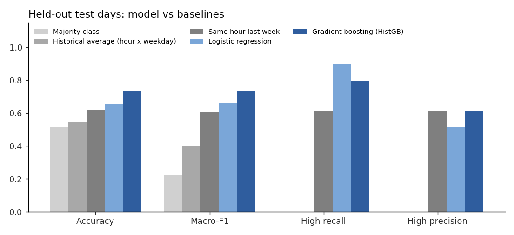
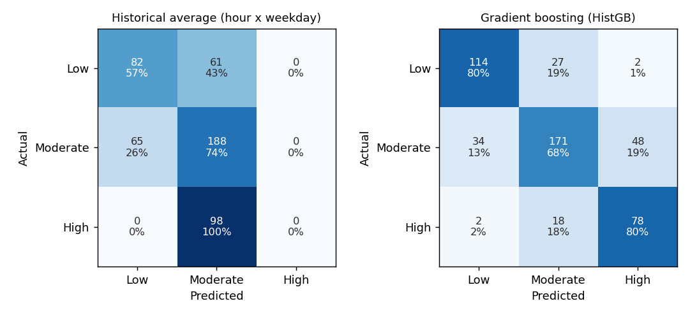
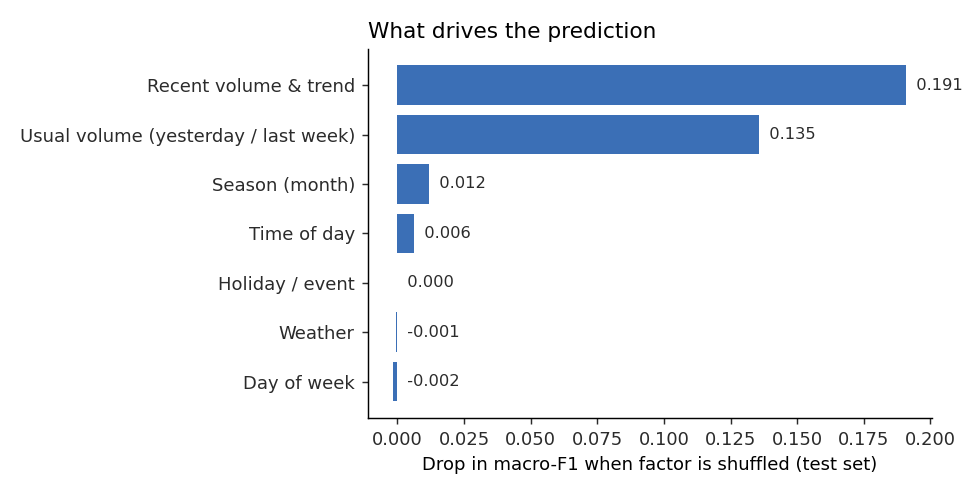

# Evaluation: Smart Traffic Congestion Alert

**Data:** real hourly vehicle counts from the UCI *Metro Interstate Traffic Volume* dataset (also mirrored on Kaggle,
CC BY 4.0): westbound I-94 (Minneapolis-St Paul), 2012-2018, with weather (OpenWeatherMap) and holiday/event flags.
The road is a **stand-in** for the campus approach road. **No live traffic feed is connected.**

**Task:** 1 hour before each weekday arrival hour (08:00-09:00 and 09:00-10:00), predict its congestion class.
Classes are a volume-to-capacity proxy: Low < 5000 veh/h, Moderate 5000-5800,
High >= 5800 (about 85% of the maximum observed throughput of ~6,900 veh/h).
Features use only information available at prediction time (completed hours, current weather, calendar).

**Split:** chronological by day. Train = 986 weekdays (1769 rows, 2012-10-03 to 2017-10-17),
held-out test = 247 weekdays (494 rows, 2017-10-18 to 2018-09-28).
Test class mix: Low 29%, Moderate 51%, High 20%.
Model chosen by 4-fold expanding-window CV over training days only (mean CV macro-F1:
Logistic regression 0.672, Gradient boosting (HistGB) 0.705) -> **Gradient boosting (HistGB)**.

## Results on the held-out test set

| Model | Accuracy | Macro-F1 | High precision | High recall | False alerts / week | Missed High / week |
|---|---|---|---|---|---|---|
| Majority class | 0.512 | 0.226 | 0.000 | 0.000 | 0.00 | 1.98 |
| Historical average (hour x weekday) | 0.547 | 0.397 | 0.000 | 0.000 | 0.00 | 1.98 |
| Same hour last week | 0.619 | 0.607 | 0.612 | 0.612 | 0.77 | 0.77 |
| Logistic regression | 0.654 | 0.660 | 0.515 | 0.898 | 1.42 | 0.28 |
| Gradient boosting (HistGB) | 0.735 | 0.733 | 0.609 | 0.796 | 0.95 | 0.40 |

Alert rule: raise a HIGH CONGESTION alert when P(High) >= 0.5. A week is 5 weekdays x 2 target hours.

## Factors that influence the prediction

Group permutation importance on the test set (all columns of a factor shuffled together, drop in macro-F1):

| Factor | Importance |
|---|---|
| Recent volume & trend | 0.191 |
| Usual volume (yesterday / last week) | 0.135 |
| Season (month) | 0.012 |
| Time of day | 0.006 |
| Holiday / event | 0.000 |
| Weather | -0.001 |
| Day of week | -0.002 |

The dashboard also shows **per-prediction** factor contributions: the change in P(High) when one factor
is reset to a "calm" reference value (median volumes, Clear weather, no rain/snow, no holiday).

## How early can we alert? (macro-F1 on held-out days)

| Prediction made | Historical-average baseline | Gradient boosting (HistGB) | Gradient boosting (HistGB) High recall |
|---|---|---|---|
| 1 h before | 0.397 | 0.733 | 0.796 |
| 2 h before | 0.396 | 0.688 | 0.923 |

## Limitations

- The congestion class is a **volume-based proxy**: the dataset has no speed or travel-time data. On a real campus
  road, label with speed or queue length (for example from a camera or GPS probes) and retrain.
- It is one highway segment, not the college's own road. The pipeline is reusable: swap in campus counts with the same columns.
- There is a sensor gap from Aug 2014 to Jun 2015. Rows whose lag features are missing are kept, and HistGB handles the NaNs natively.
- The weather input is the latest observation at prediction time, not a forecast. A weather-forecast API would help.
- The holiday flag covers US public holidays and the State Fair. College events (fests, exams) would need a campus calendar.
